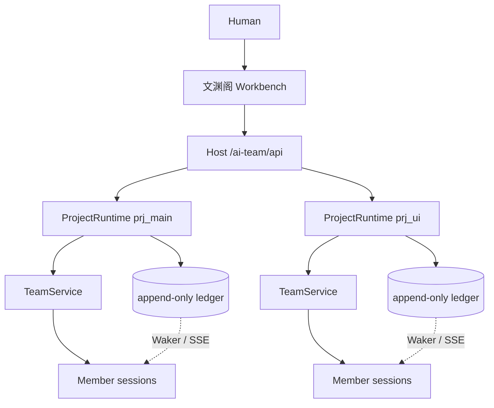

<p align="center">
  
</p>

<h1 align="center">文渊阁</h1>

<p align="center">
  <strong>把工作交给一支 AI 团队：它们把事做到底，你定方向、把关键的关。</strong>
</p>

<p align="center">
  <a href="https://www.npmjs.com/package/@suifei/dsh-ai-team"></a>
  <a href="https://github.com/suifei/dsh-ai-team/releases"></a>
  <a href="./LICENSE"></a>
  
  
  <a href="https://github.com/suifei/dsh-ai-team/stargazers"></a>
</p>

<p align="center">觉得有用？点右上角 ⭐ <a href="https://github.com/suifei/dsh-ai-team">Star</a> 支持一下，也欢迎 <a href="https://github.com/suifei/dsh-ai-team/issues">提 issue</a> 和 <a href="https://github.com/suifei/dsh-ai-team/pulls">发 PR</a>。</p>

> 文渊阁，藏修、校勘、纂辑之地。  
> 在这里，Human 不在环里逐条调度，而是在环上定方向、守信任、做最后那一步。

`@suifei/dsh-ai-team` 是 DeepSeek Harness 的按需启用插件：装进专用 `ai-team` profile 后，DSH 里出现一个三栏工作台——左侧 Project 与成员，中间主对话 / 看板 / 态势，右侧 Thread。Agent 自己认领 Task、互相交接，由做的人以外的成员验收；Human 只处理方向、信任和不可撤回的决定。

新 Project 自带一组可改的默认成员：**墨渊（主理人）**、**青岚（执行）**、**白砚（验收）**、**玄策（编程）**、**知微（UX 设计）**、**观澜（业务）**。名字、职责、个性、模型都可以改；模型提供商和模型名称直接读取 DSH 的 `llm` 目录，不需要手填 id。

主理人只调度交付：产出只交给对应角色，主理人不看、不核对成果内容，只问负责人做全没有——没做全催继续，做全了交给下一位；内容对不对由验收人把关，主理人不能验收或退回别人的产出。

## 最近更新

- **输入框与 @成员**（0.4.120–0.4.123）：输入框随内容长高、可拖大；能贴图、拖文件、选附件；@ 能点名具体成员，被 @ 的成员可以直接在主对话回你；成员可一键复制。文渊阁对话框和 DSH 标准会话（「文渊阁·PMO」）是同一套实现（感谢 [@xiuchuan666](https://github.com/xiuchuan666) 的反馈与建议，#65）。
- **人才市场**（0.4.124–0.4.129）：9 个内置团队、44 位内置人才，各自带看家技能。可以招聘、复制为可编辑、自建人才并装技能，也能把项目成员「存为人才」；新建项目时选团队，或从人才里挑人组新团队（源自 [@xiuchuan666](https://github.com/xiuchuan666) 在 #65 里的建议）。
- **主理人只调度交付**（0.4.128）：主理人不看产出，只问负责人做全没有；内容由验收人把关。
- **在线人才库**（0.4.130–0.4.131）：「同步在线库」从 [`@suifei/dsh-ai-team-catalog`](https://www.npmjs.com/package/@suifei/dsh-ai-team-catalog) 拉取最新的人才与团队。国内走 npmmirror 整包下载，约 1 秒同步完；逐个文件核对 sha256，失败不影响旧版本，可一键退回内置。
- **头像**（0.4.135–0.4.136）：人才市场、团队、成员卡片都有头像，由 [`@suifei/hash-avatar`](https://www.npmjs.com/package/@suifei/hash-avatar) 在本机按名字生成。这个库**不随插件打包**：插件运行时从 npm 取最新版并缓存在本机，库更新了插件不用重发，新增的种族、画风直接出现在挑选界面里。内置人才预置了参数（默认亚洲人），自定义成员和人才可以选性别、年龄、种族（人类 / 奇幻 / 动物 / 科幻共 88 种）和画风（扁平、像素、水墨等 10 种）。
- **PMO 会话里的收工汇报**（0.4.137）：成员收工后，「【项目】文渊阁·PMO」会话里直接显示它的收工汇报全文，开头带成员头像和名字，不经过模型。
- **热重载后的唤醒**（0.4.138）：插件关再开（含升级）时正在跑回合的成员，暂时收不到唤醒；插件把这些唤醒暂存起来，等那个回合结束后自动补投，不再记成失败。
- **Grok 4.7 可用**（0.4.139）：插件注册的工具参数都是标准的对象 JSON Schema，Grok 4.7 等严格校验工具定义的模型不再在第一条回复前报 HTTP 400（感谢 [@TardisBooo](https://github.com/TardisBooo)，#88）。
- **团队扩编**（0.4.140–0.4.142）：多加不同的 AI 员工来提速，不把一个成员克隆成几份。成员超过 DSH 同时运行的上限（默认 8）时，多出的人排队，不再被判失败；开发与验收 1:1 配对，只有一位验收人时大家排队等他验；空闲的开发由 PMO 马上派活，新加的人下一分钟就有活；卡可以写写入范围，与别人正在改的文件重叠就不让认领；推进慢时，收件箱里会有加开发或加验收的建议，由你决定加不加；如果是有人停摆（比如模型报错），建议会改成先恢复他，不必加人；建议里每张卡、每位停摆的成员都有自己的按钮（感谢 [@xiuchuan666](https://github.com/xiuchuan666) 的建议，#65）。
- **弹窗与人员池**（0.4.132–0.4.133）：
  - 弹窗占主页面的 90%，功能按钮固定在右上角。
  - 成员资料按「资料 / 模型 / 技能 / 协作」分页签。
  - 新建项目时展示团队成员卡片；组队是三栏：人才列表 → 简介 → 已选成员。
  - 人员池是成员卡片，可以一次给多位成员批量配置模型。

<p align="center">
  <br/>
  <sub>人才市场：每位人才都有自己的头像，同步在线库后按分类挑人</sub>
</p>

<p align="center">
  <br/>
  <sub>项目里：左栏成员和对话消息都带头像</sub>
</p>

<p align="center">
  <br/>
  <sub>成员资料：头像可选性别、年龄、人种，左侧实时预览</sub>
</p>

<p align="center">
  <br/>
  <sub>新建项目：选团队后右侧展示每位成员的卡片</sub>
</p>

完整记录见 [CHANGELOG](./CHANGELOG.md)。

### 顺带做了个头像库：hash-avatar

为了让人才市场里的每位人才都有一张自己的脸，我们另做了一个开源库 **[`@suifei/hash-avatar`](https://www.npmjs.com/package/@suifei/hash-avatar)**（[GitHub](https://github.com/suifei/hash-avatar)）<a href="https://github.com/suifei/hash-avatar/stargazers"></a>，同样欢迎 Star。文渊阁的头像就是它在本机生成的。

<p align="center">
  
  
  
  
  
  
</p>

- **由名字或 email 确定**：输入经 SHA-256 决定五官、发型和配色；同一个名字永远是同一张脸。外圈 128 个刻度画出哈希的前 128 位，两个不同输入撞上同一张图的概率低于 UUIDv4 撞车。
- **性别、年龄、种族、画风只是渲染参数**，不进哈希，所以换参数后还是认得出同一个人：`gender=male|female|neutral`、`age=baby|teen|youth|middle|old`；`race` 有人类、奇幻与神话、动物、科幻与奇物四组共 88 种（如 `asian`、`elf`、`fox`、`robot`）；`art` 有 `flat`、`pixel`、`ink`、`comic`、`watercolor` 等 10 种画风。
- **零依赖、同步、浏览器和 Node 都能用**，一张约 0.1 ms、约 6 KB 的 SVG；Apache-2.0。
- **不写代码也能用**：`https://avatar.onrpc.com/<名字>.svg?gender=female&age=youth&race=asian` 直接当图片地址。

```sh
npm i @suifei/hash-avatar
```

```js
const HashAvatar = require('@suifei/hash-avatar');
const svg = HashAvatar.svg('墨渊', { gender: 'male', age: 'middle', race: 'asian', size: 128 });
```

**人才市场**：成员来自可复用的「人才」，团队从人才里挑人组队。

- 人才 `talents/<人才>/talent.yml`：名字、岗位、`duty`（职责：`lead` 主理人 / `qa` 验收 / `executor` 执行，决定拿哪份岗位规程）、头像参数 `avatar: { gender, age, race }`、性格、分类与标签、推荐模型，以及自带技能（`talents/<人才>/skills/<技能>/SKILL.md`）。内置 10 位：默认团队的 6 位，外加架构、评审、技术文档、安全审计。
- 团队 `teams/<团队>/team.yml`：只引用人才（可覆盖名字、岗位、性格，追加技能），`skills/` 放这个团队的三份岗位规程（`ai-team-core` / `ai-team-qa` / `ai-team-executor`），`procedures` 可换成自己的规程。内置默认团队见 [`teams/default/`](teams/default/)。还预置了**逆向工程队** [`teams/reverse/`](teams/reverse/)：静态分析、动态调试、OLLVM 去混淆、移动端逆向、算法复刻与行为对账（`teamPreset: reverse` 启用）。此外预置了文档（`docs`）、视频（`video`）、游戏（`game`）、自媒体写作（`content`）、深度研究（`research`）、科学研究（`science`）、中小学教育软件（`education`）等团队,共 44 位人才可在人才市场挑选、组合或自建。
- 「人员 → 添加成员」先打开人才市场：按分类、关键词挑一位，点「招聘」预填表单，改名、换模型后创建；也可以切到「自定义」从零填写。
- 自建：人才放 `~/.dsh/ai-team/catalog/user/talents/<人才>/`，团队放 `~/.dsh/ai-team/catalog/user/teams/<团队>/`，同名覆盖内置；插件设置 `teamPreset` 选新项目用哪个团队。
- **新建自定义人才（界面）**：「添加成员 → 新建人才」填名号、岗位、职责、性格，再按需装技能——从现成人才 fork、自写一份、或导入 `.md`，存成可复用的人才（落用户根）。内置没有的角色能自己攒；技能装进人才自己的文件夹，自包含、可分享。走 `POST /api/talents` 与 `POST /api/talents/:id/skills`，内置只读、装删回 `409`。
- **存为人才**：成员资料「存为人才」把项目里这位成员此刻的岗位、职责、性格、模型与技能存成可复用的人才（技能按成员实际读取的路径拷进人才文件夹，找不到正文的会提示），换个项目照样招。新建与存为都不会静默覆盖已有人才，撞名自动加序号。
- **组队、建项目选团队**：「新建项目」里选团队（内置或自建），按它种成员、负责人当主理人；「组一个新团队」从人才里挑人（同一人才可招多位）、指定负责人即可保存。插件设置 `teamPreset` 只是不选时的默认值。
- **改内置人才、进化技能**：内置人才点「复制为可编辑」得到同 id 的副本（随时「恢复内置」）；成员资料里技能旁的「进化」会让该成员用 SkillOpt 优化那份技能——内置的先自动复制，插件里的原文件不动。
- **在线人才库同步**：人才市场顶部「同步在线库」从官方在线人才库 [`@suifei/dsh-ai-team-catalog`](https://www.npmjs.com/package/@suifei/dsh-ai-team-catalog)（npmmirror → jsDelivr → npmjs；registry 下整包核对 integrity）取最新的人才与团队，按 `index.json` 逐文件核对 sha256 后整体替换，落到 `~/.dsh/ai-team/catalog/official/<版本>/`；失败不动现有的。优先级：自建 > 在线 > 内置（插件升级后内置版本更高的人才用内置）。「退回内置」删掉本机在线库。内网可设环境变量 `DSH_AI_TEAM_CATALOG_MIRROR` 指向 npmmirror 同形的私有源。在线人才同样只读，可「复制为可编辑」。
- 成员在账本里记下来源人才与版本、职责；人才文件之后再改，不会悄悄改动已招成员的性格与职责。已有项目不受新团队影响。文件写坏时跳过它并在诊断日志记 `catalog.load.fail` / `catalog.team.fail`。

---

## 为什么是「文渊阁」

- **成员是持久的。** 每个 Agent 有名字、角色、personality、notes、skills 和 session；DSH 重启、上下文压缩、换代之后，它还是它。
- **每个结果都有 owner。** Project 有具名 owner；Task 有唯一 accountable owner，由它推到验收。
- **做的人不验收。** Agent 只能验收已进入待验收、且自己从未认领过的 Task；QA Task 只有 QA 成员能验收。
- **房间是为 Agent 设计的。** 成员从自己的 inbox 拉取消息，而不是被每条消息推着走；对着已经变化的 Thread 写的回复会被退回，并附上变化摘要。
- **一切有记录。** Main stream、Thread、Task、收件箱都是同一本 append-only 账本的视图。
- **没有定时器。** Agent 只由 Team 事件（消息、@、交接、验收请求）唤醒；团队完全安静时不会自己醒来。

---

## 快速开始

### 1. 建专用 profile

```powershell
dsh --profile ai-team --from-default-profile web --dump-config
```

### 2. 从 npm 安装

```powershell
dsh plugin --profile ai-team add @suifei/dsh-ai-team
```

或从 checkout 安装：

```powershell
dsh plugin --profile ai-team add E:/works/dsh-ai-team
```

### 3. 启动

```powershell
dsh --profile ai-team --no-open --port 33271
```

打开终端输出的 URL，点侧栏 **文渊阁**。

第一次进入 Project 先设置 **工作目录**：工作目录编辑器会自动弹出，并预填宿主给出的建议值——配置项 `defaultWorkspace` → 当前进程目录 → **`~/works`**（Windows 为 `%USERPROFILE%\works`，Linux/macOS 为 `~/works`；不存在时自动创建）。点「选择目录」或用输入框改成任意已存在的目录即可；**新建项目必须填工作目录**（服务端强制，空目录会被 400 拒绝）。每个 Project 独立一个目录，成员只在这个目录里执行 Task。

> 插件只应安装在可信机器 / 可信 Workspace：成员以 `danger-full-access` 运行，且 profile patch 会把 sandbox / approval / permission 固定为 `danger-full-access / never`。普通 `desktop`/`web` profile 不安装时保持原有 preset roster。

---

## 界面

```text
┌ 文渊阁 ───────────────────────────────────────────────────────────┐
│ Projects        │  Main stream / Board / Situation   │  Thread     │
│  # 我的项目      │  主对话：一句话开工                 │  回复        │
│  # UI 项目       │  看板：待处理 / 进行中 / 待验收 / 完成│  验收 / 退回  │
│                 │  态势：需要你 / 团队在做 / 等待受阻 / 最近完成 │ 任务动作     │
│ Agents          │                                    │             │
│  墨渊 (Lead)     │                                    │             │
│  白砚 (QA)       │                                    │             │
└─────────────────┴────────────────────────────────────┴─────────────┘
```

- **主对话**：Human 的一句话进入 Main stream，Project owner 拆 Task；顶部「团队动态」直接显示正在推进的 Task 和运行中的成员，点击 Task 可打开 Thread。
- **PMO 全自动**：Project header 的「PMO 自动」默认开启；每 60s 按最高价值建议自动处理 Human 决策，无 active Task 时自动唤醒 owner 续派下一批 Task；关闭后决策回到收件箱。PMO 只能由插件算法执行，不接受外部人工/脚本指挥。
- **看板**：四列；进行中的卡片显示 accountable owner 与执行者；数量只统计 active Task。
- **态势**：四象限——需要你、团队在做、等待受阻、最近完成。点击条目打开对应 Task 的 Thread。
- **收件箱**：跨 Project 聚合；顶部「待你处理 · N」一键进入；只放真正需要 Human 的决策/失败，Agent 的进度汇报留在 Thread/动态，不制造“打开 Task 后无事可做”。
- **直接对话**：点击成员名字直接打开该 Agent 的 DSH 原生 Session；没有 session 会先激活；打不开时落到成员资料，资料里有「直接对话」按钮。
- **成员任务**：成员资料里点「他的任务」，查看他 owner/assignee 的 Task。
- **成员资料**：点「⋯」打开，按「资料 / 模型 / 技能 / 协作」分页签：改名、职责、个性、备忘；运行配方、提供商 / 模型 / 推理等级；技能与「进化」；交接人与私信。右上角是他的任务、直接对话、复制成员、存为人才、重置会话、重新蒸馏、离开团队。
- **人员池**：按人汇总各项目里的成员卡片（负载、所在项目、跳转）；「批量配置模型」一次给勾选的成员在其所在的全部项目设同一模型，卡片上的「配置模型」只改这一位。

---

## 能力地图

| 能力 | 说明 |
|---|---|
| Project | 具名 owner；独立工作目录；并发 runtime；每 Project 独立账本、Waker、SSE |
| Task | 唯一 accountable owner；pending / in_progress / pending_acceptance / done / cancelled |
| Thread | append-only；回复带 `baseSeq`，旧基线会被拒并说明变化 |
| 验收 | maker 不能验收；QA 硬门禁；`qaChecklist` 逐项通过 |
| 收件箱 | Human/Agent 各自拉取；跨 Project 聚合；顶部待办入口；`askHuman` 结构化问题与选项直接展开并提交 |
| 关注 | 关注 Task；完成后收到 `followed_task_update` |
| 默认成员 | 新 Project 按团队（`teams/<团队>/`，从人才市场 `talents/` 挑人，设置项 `teamPreset`）初始化成员，默认墨渊 / 青岚 / 白砚 / 玄策 / 知微 / 观澜；可改名、改职责、改个性、改模型 |
| 成员 | 持久 session；点击名字直接对话；「⋯」资料里有任务视图与直接对话 |
| 模型 | Provider / Model 下拉读取 DSH `llm` 目录；可跟随系统默认 |
| 进化 | `team.evolve` 只改自己的 personality；验收后 reflection wake |
| 人才库 | leave/rejoin；遗留 Task 可被接管（taken-over） |
| 运行配方 | `standard` / `ptc` / `minimal` / `cordis` |
| 技能 | DSH `skill` 工具真实加载；SkillOpt 7 工具内置 |
| 重启恢复 | `team/startup` 恢复未完成 Task，无定时器 |
| 安全 | 每次成员工具调用前守卫 `danger-full-access` |

---

## 架构



- **Host**：路由、命令、SSE、Waker、成员 runtime、权限守卫。
- **ProjectRuntime**：一个 Project 一个 ledger + TeamService；启动时全部打开。
- **Ledger**：JSONL + SHA-256 hash chain + checkpoint + 纯函数 fold。
- **MemberRuntime**：真实 DSH Agent session，直接 `agents.create` / `followup`，没有模拟执行。
- **Waker**：只从账本 append / HTTP 命令结果计划唤醒；没有 heartbeat/timer。

### API 速览

```text
GET  /ai-team/api/health
GET  /ai-team/api/bootstrap?project=<id>
GET  /ai-team/api/projects/<id>/board
GET  /ai-team/api/projects/<id>/quadrants
GET  /ai-team/api/projects/<id>/events      # SSE
POST /ai-team/api/projects/<id>/commands
```

命令覆盖 `task.create/claim/submit/accept/request_changes/cancel/reopen/delete/reassign`、`member.add/activate/config.update/profile.update/message/leave/rejoin/takeover`、`project.create/activate`、`inbox.ack` 等。

---

## 技能与 SkillOpt

一个智能体 = 岗位 + 职责 + 性格 + 装上的若干技能（`skills` 数组）。内置人才里每个干活角色（执行 / 验收）都带一份看家技能；负责人只靠岗位规程 + 性格。

- 成员资料可追加 notes / skills，activation / wake prompt 会注入有界技能目录；
- 完整技能正文由成员自己的 `skill` 工具加载；
- **技能从四个根按优先级读，低序号覆盖高序号**，所以"安装一份技能"= 把 `SKILL.md` 落到可写根，再在成员 `skills` 里写上它的名字：
  - `<cwd>/.dsh/skills`（项目，100，最高）
  - `<cwd>/.agents/skills`（项目，200）
  - `<DSH_HOME>/skills`（用户，400）
  - 插件内置（600，**只读**）
- **自定义智能体**：在 `~/.dsh/ai-team/catalog/user/talents/<人才>/` 写一份 `talent.yml`（职责 + 性格 + `skills: [...]`），技能来源可以是自己写的、从别处装的、或从现成人才拆出来的；同名覆盖内置，即可加进团队。
- **自我进化两条链**：性格靠成员 `evolve` / `distill` 自长自压（写账本，开箱即用）；技能靠内置 SkillOpt 过门禁优化 `SKILL.md`。注意内置技能在包内**只读**，要就地进化需先把它复制（fork）到可写根再改。
- **Microsoft SkillOpt 已内置**：7 个 `skillopt_*` 工具、Python engine bootstrap、`skillopt-sleep` 技能随插件分发，不需要单独安装 `dsh-skillopt`。

---

## 验证

- `node --test`：**269 通过 / 1 跳过**（跳过项是目录 junction 用例，本机沙箱不允许创建）
- 真实账本副本干跑（`.ptc/rounds/dryrun-real-ledger.mjs`，可重复运行、不写生产数据）：
  用**已安装的 npm 产物**启动真实项目账本，核对 `health` / `bootstrap` / `/people` /
  `project.repair`（`acceptedRange` + `seqGaps`）/ 新建项目空目录被 400 拒绝
- 重启后验证清单：`.ptc/rounds` 与 `docs/重启后验证清单-*.md`（6 步，含命令与预期）
- npm 产物一致性：远端 tarball 与本地安装副本逐文件 SHA256 比对
- 真实 E2E 覆盖：
  - 两 Agent claim → Thread → 独立验收；
  - 一句话 → Lead 开卡 → QA 自动验收 → owner 自进化；
  - 强停重启 → `startup_resume` → 继续 Task（一个成员一个会话：续接走 `subagents.sendMessage` 冷恢复；会话确实无法续接时不新建子智能体，成员转 failed 并给 Human 决策项，见 `member.session.unresumable.fail`）；
  - 真实浏览器私信成员；
  - 四运行配方分别执行 `run_code` / `pwsh`；
  - 并发 Project + 跨 Project 收件箱；
  - DeepSeek + Zhipu 双订阅 SSE 分桶；
  - V-10 turn 中途权限降级后工具前修复；
  - billing 402 / ECONNRESET 三次重试与恢复；
  - 从 npm 安装后在独立 profile 启动 health 200；
  - 归档 host 自动解归档（`host.repair.ok`，带解归档数量）；
  - 诊断日志分级：发布默认 `errors` 只保留失败与关键成功行（`host.repair.ok` / `member.session.reused` / `workspace.detach`），且诊断目录跟随 `DSH_HOME`。

证据目录（本机 `.ptc/rounds/`，不随 npm 发布）：

```text
round-02  两 Agent 独立验收
round-06  验收后 self-evolve
round-09  重启 startup_resume
round-10  资料抽屉私信
round-11  多 Project 新建/切换
round-12  成员工具链 + skill 加载
round-13  四种运行配方
round-14  安装/卸载 smoke
round-15  并发/收件箱/V-10/billing
round-16  四技能安装
round-17  SkillOpt 内置 + 冷恢复
round-18  跨 Project 打开 Task + SSE 分桶
round-19  DeepSeek + Zhipu 双 provider
```

---

## 文档（仅本地）

需求、架构、UI 研究、验收报告保存在本机 `docs/`，**不随 GitHub 仓库或 npm 包发布**。  
仓库只保留 README、CHANGELOG 与运行所需的源码 / 技能。

---

## 当前边界

- 单机、单 Human；不支持多 Human 共享 Team；
- billing/网络注入是测试 adapter，不是物理断网；
- SSE 分桶用两个真实 provider 的独立订阅端验证，不是两个浏览器窗口；
- distilly / darwin 不内置，有则用、无则不用；`huashu-nuwa` 已被 Team 技能目录排除。
- desktop profile 由插件 patch 固定为 `danger-full-access / never`，只应在可信机器使用。

## 参与贡献

欢迎 ⭐ [Star](https://github.com/suifei/dsh-ai-team)，这是对我们最直接的鼓励。

- **用着有问题、有想法**：到 [Issues](https://github.com/suifei/dsh-ai-team/issues) 说一声，附上截图或诊断日志最好。
- **想动手改**：Fork 后开分支提 [PR](https://github.com/suifei/dsh-ai-team/pulls)，改行为的代码请配测试，`node --test` 全绿再提交。
- **贡献人才和团队**：新的人才（`talents/<人才>/talent.yml`）和团队（`teams/<团队>/team.yml`）都欢迎，合并后会随在线人才库发给所有用户。
- **头像库**：[hash-avatar](https://github.com/suifei/hash-avatar) 同样欢迎 Star 和贡献新的种族、画风。

### 致谢

带来重要进展的反馈和代码，都会在这里和对应的「最近更新」条目里点名感谢。

| 贡献者 | 贡献 | 带来的进展 |
|---|---|---|
| [@xiuchuan666](https://github.com/xiuchuan666) | 反馈与建议 [#65](https://github.com/suifei/dsh-ai-team/issues/65) | 输入框长高可拖大、贴图拖文件、@ 点名成员（0.4.120–0.4.123）；人才市场与在线人才库（0.4.124–0.4.131）；团队扩编：超限排队、开发验收配对、空闲必派、写入范围、加人建议（0.4.140） |
| [@TardisBooo](https://github.com/TardisBooo) | 代码 [#88](https://github.com/suifei/dsh-ai-team/pull/88) | 工具参数改为对象 JSON Schema，Grok 4.7 可用（0.4.139） |

---

## License

MIT。  
Bundled SkillOpt integration derives from [Microsoft SkillOpt](https://github.com/microsoft/SkillOpt) `plugins/dsh` (MIT); its license lives at `lib/vendor/skillopt/LICENSE`.
