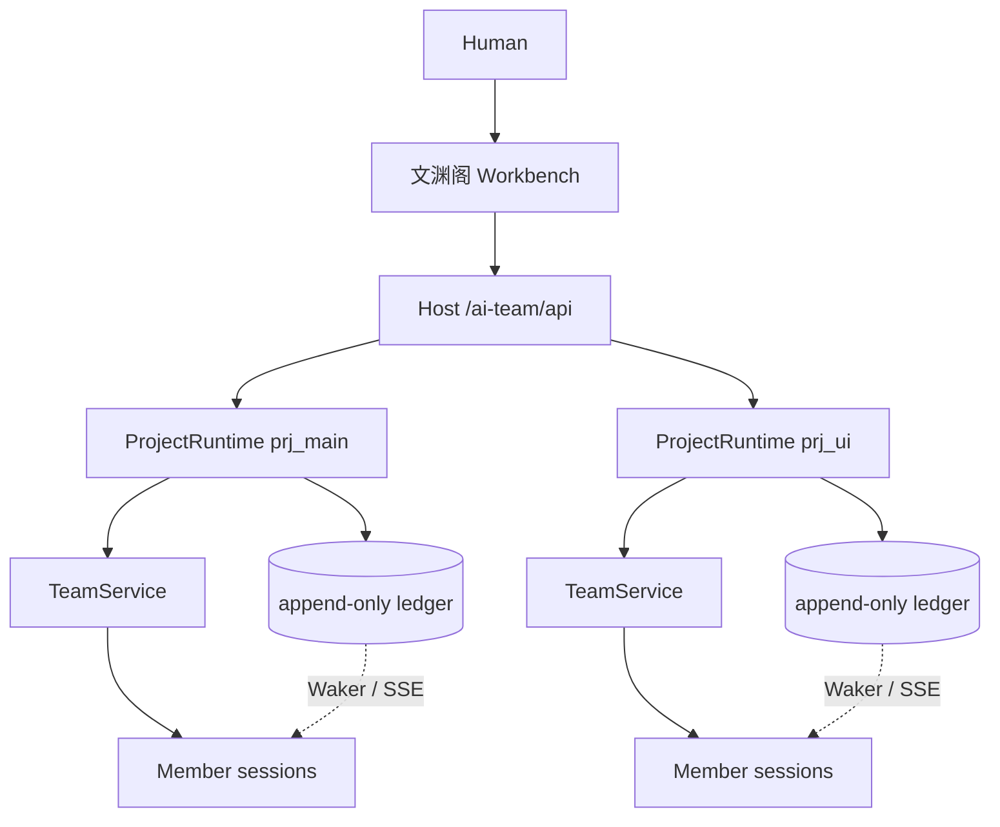

<p align="center">
  
</p>

<h1 align="center">文渊阁</h1>

<p align="center">
  <strong>把工作交给一支 AI 团队：它们把事做到底，你定方向、把关键的关。</strong>
</p>

<p align="center">
  <a href="https://www.npmjs.com/package/@suifei/dsh-ai-team"></a>
  <a href="https://github.com/suifei/dsh-ai-team/releases"></a>
  <a href="./LICENSE"></a>
  
  
</p>

> 文渊阁，藏修、校勘、纂辑之地。  
> 在这里，Human 不在环里逐条调度，而是在环上定方向、守信任、做最后那一步。

`@suifei/dsh-ai-team` 是 DeepSeek Harness 的按需启用插件：装进专用 `ai-team` profile 后，DSH 里出现一个三栏工作台——左侧 Project 与成员，中间主对话 / 看板 / 态势，右侧 Thread。Agent 自己认领 Task、互相交接，由做的人以外的成员验收；Human 只处理方向、信任和不可撤回的决定。

---

## 为什么是「文渊阁」

- **成员是持久的。** 每个 Agent 有名字、角色、personality、notes、skills 和 session；DSH 重启、上下文压缩、换代之后，它还是它。
- **每个结果都有 owner。** Project 有具名 owner；Task 有唯一 accountable owner，由它推到验收。
- **做的人不验收。** Agent 只能验收已进入待验收、且自己从未认领过的 Task；QA Task 只有 QA 成员能验收。
- **房间是为 Agent 设计的。** 成员从自己的 inbox 拉取消息，而不是被每条消息推着走；对着已经变化的 Thread 写的回复会被退回，并附上变化摘要。
- **一切有记录。** Main stream、Thread、Task、收件箱都是同一本 append-only 账本的视图。
- **没有定时器。** Agent 只由 Team 事件（消息、@、交接、验收请求）唤醒；团队完全安静时不会自己醒来。

---

## 快速开始

### 1. 建专用 profile

```powershell
dsh --profile ai-team --from-default-profile web --dump-config
```

### 2. 从 npm 安装

```powershell
dsh plugin --profile ai-team add @suifei/dsh-ai-team
```

或从 checkout 安装：

```powershell
dsh plugin --profile ai-team add E:/works/dsh-ai-team
```

### 3. 启动

```powershell
dsh --profile ai-team --no-open --port 33271
```

打开终端输出的 URL，点侧栏 **文渊阁**。

> 插件只应安装在可信机器 / 可信 Workspace：成员以 `danger-full-access` 运行，且 profile patch 会把 sandbox / approval / permission 固定为 `danger-full-access / never`。普通 `desktop`/`web` profile 不安装时保持原有 preset roster。

---

## 界面

```text
┌ 文渊阁 ───────────────────────────────────────────────────────────┐
│ Projects        │  Main stream / Board / Situation   │  Thread     │
│  # 我的项目      │  主对话：一句话开工                 │  回复        │
│  # UI 项目       │  看板：待处理 / 进行中 / 待验收 / 完成│  验收 / 退回  │
│                 │  态势：需要你 / 团队在做 / 等待受阻 / 最近完成 │ 任务动作     │
│ Agents          │                                    │             │
│  沈舟 (Lead)     │                                    │             │
│  林岚 (QA)       │                                    │             │
└─────────────────┴────────────────────────────────────┴─────────────┘
```

- **主对话**：Human 的一句话进入 Main stream，Project owner 拆 Task；Composer 支持讨论 / 任务模式。
- **看板**：四列；进行中的卡片显示 accountable owner 与执行者；数量只统计 active Task。
- **态势**：四象限——需要你、团队在做、等待受阻、最近完成。点击条目打开对应 Task 的 Thread。
- **收件箱**：跨 Project 聚合；失败决策、需要你决定、关注 Task 的完成报告都在这里。
- **成员资料**：改名、职责、personality、provider/model、运行配方、notes、skills、re-distill、离队/人才库。

---

## 能力地图

| 能力 | 说明 |
|---|---|
| Project | 具名 owner；并发 runtime；每 Project 独立账本、Waker、SSE |
| Task | 唯一 accountable owner；pending / in_progress / pending_acceptance / done / cancelled |
| Thread | append-only；回复带 `baseSeq`，旧基线会被拒并说明变化 |
| 验收 | maker 不能验收；QA 硬门禁；`qaChecklist` 逐项通过 |
| 收件箱 | Human/Agent 各自拉取；跨 Project 聚合与项目内 ack |
| 关注 | 关注 Task；完成后收到 `followed_task_update` |
| 成员 | 持久 session；名字/角色/personality/notes/skills |
| 进化 | `team.evolve` 只改自己的 personality；验收后 reflection wake |
| 人才库 | leave/rejoin；遗留 Task 可被接管（taken-over） |
| 运行配方 | `standard` / `ptc` / `minimal` / `cordis` |
| 技能 | DSH `skill` 工具真实加载；SkillOpt 7 工具内置 |
| 重启恢复 | `team/startup` 恢复未完成 Task，无定时器 |
| 安全 | 每次成员工具调用前守卫 `danger-full-access` |

---

## 架构



- **Host**：路由、命令、SSE、Waker、成员 runtime、权限守卫。
- **ProjectRuntime**：一个 Project 一个 ledger + TeamService；启动时全部打开。
- **Ledger**：JSONL + SHA-256 hash chain + checkpoint + 纯函数 fold。
- **MemberRuntime**：真实 DSH Agent session，直接 `agents.create` / `followup`，没有模拟执行。
- **Waker**：只从账本 append / HTTP 命令结果计划唤醒；没有 heartbeat/timer。

### API 速览

```text
GET  /ai-team/api/health
GET  /ai-team/api/bootstrap?project=<id>
GET  /ai-team/api/projects/<id>/board
GET  /ai-team/api/projects/<id>/quadrants
GET  /ai-team/api/projects/<id>/events      # SSE
POST /ai-team/api/projects/<id>/commands
```

命令覆盖 `task.create/claim/submit/accept/request_changes/cancel/reopen/delete/reassign`、`member.add/activate/config.update/profile.update/message/leave/rejoin/takeover`、`project.create/activate`、`inbox.ack` 等。

---

## 技能与 SkillOpt

- 成员资料可追加 notes / skills，activation / wake prompt 会注入有界技能目录；
- 完整技能正文由成员自己的 `skill` 工具加载；
- `ai-team-files` provider 会读取：
  - `<DSH_HOME>/skills`
  - `<cwd>/.dsh/skills`
  - `<cwd>/.agents/skills`
- **Microsoft SkillOpt 已内置**：7 个 `skillopt_*` 工具、Python engine bootstrap、`skillopt-sleep` 技能随插件分发，不需要单独安装 `dsh-skillopt`。

---

## 验证

- `node --test`：**82 / 82**
- 文档 QA：`node .ptc/tools/docs_check.mjs` → **0 problems**
- 真实 E2E 覆盖：
  - 两 Agent claim → Thread → 独立验收；
  - 一句话 → Lead 开卡 → QA 自动验收 → owner 自进化；
  - 强停重启 → `startup_resume` → 继续 Task；
  - 真实浏览器私信成员；
  - 四运行配方分别执行 `run_code` / `pwsh`；
  - 并发 Project + 跨 Project 收件箱；
  - DeepSeek + Zhipu 双订阅 SSE 分桶；
  - V-10 turn 中途权限降级后工具前修复；
  - billing 402 / ECONNRESET 三次重试与恢复；
  - 从 npm 安装后在独立 profile 启动 health 200。

证据目录（本机 `.ptc/rounds/`，不随 npm 发布）：

```text
round-02  两 Agent 独立验收
round-06  验收后 self-evolve
round-09  重启 startup_resume
round-10  资料抽屉私信
round-11  多 Project 新建/切换
round-12  成员工具链 + skill 加载
round-13  四种运行配方
round-14  安装/卸载 smoke
round-15  并发/收件箱/V-10/billing
round-16  四技能安装
round-17  SkillOpt 内置 + 冷恢复
round-18  跨 Project 打开 Task + SSE 分桶
round-19  DeepSeek + Zhipu 双 provider
```

---

## 文档

- [需求研究](docs/01-需求研究报告.md)
- [PRD](docs/02-产品需求文档-PRD.md)
- [架构设计](docs/03-架构设计报告.md)
- [UI/UX/UE 研究](docs/04-UI-UX-UE研究报告.md)
- [启动与执行计划](docs/05-项目启动与执行计划.md)
- [会议纪要](docs/06-会议纪要.md)
- [四象限设计](docs/07-四象限视图研究与设计.md)
- [异常恢复与模型治理](docs/08-异常恢复与模型治理.md)
- [团队进化与人才库](docs/09-团队进化与人才库.md)
- [安装、卸载与升级](docs/10-安装卸载升级.md)
- [M3 并发多项目与边界补齐](docs/reports/M3-并发多项目与边界补齐.md)

---

## 当前边界

- 单机、单 Human；不支持多 Human 共享 Team；
- billing/网络注入是测试 adapter，不是物理断网；
- SSE 分桶用两个真实 provider 的独立订阅端验证，不是两个浏览器窗口；
- nuwa / distilly / darwin 不内置，有则用、无则不用；
- desktop profile 由插件 patch 固定为 `danger-full-access / never`，只应在可信机器使用。

---

## License

MIT。  
Bundled SkillOpt integration derives from [Microsoft SkillOpt](https://github.com/microsoft/SkillOpt) `plugins/dsh` (MIT); its license lives at `lib/vendor/skillopt/LICENSE`.
